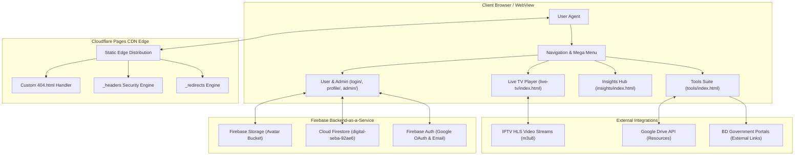

# Digital Seba — System Architecture Documentation

**Platform:** Cloudflare Pages Static Edge Network
**Custom Domains:** `digitalseba.pages.dev` | `digiseba.shop` | `seba.pro.bd`
**Backend:** Serverless BaaS (Firebase Auth, Cloud Firestore, Firebase Storage)
**Last Verified Baseline:** October 19, 2026 (`main` branch)
**Document Status:** ACTIVE & MAINTAINED

---

## 1. Architectural Overview & System Design

Digital Seba is architected as a **decoupled, serverless static frontend application** deployed globally across Cloudflare Pages.

The site does not employ a monolithic server-side rendering (SSR) application server (such as Node.js, Express, or Django) in production. Instead, all HTML documents, CSS stylesheets, images, and client-side JavaScript bundles are distributed statically. Dynamic state, user identity, and persistent data are handled through direct client-to-cloud connections using Google Firebase APIs and public web services.



---

## 2. Verified Technology Stack

| Layer | Technologies Used | Repository Verification Evidence |
| :--- | :--- | :--- |
| **Frontend Core** | HTML5, CSS3, Vanilla JavaScript (ES6+) | All root and subfolder templates (`index.html`, `tools/`, `services/`, `admin/`, etc.) |
| **UI Frameworks** | Tailwind CSS (CDN runtime), Font Awesome 6.4, Inter, Noto Sans Bengali | `<link rel="stylesheet">` and CDN `<script>` tags across HTML heads |
| **Deployment & Edge** | Cloudflare Pages, custom domain CNAME | [`_redirects`](../_redirects), [`_headers`](../_headers), [`CNAME`](../CNAME) |
| **Authentication** | Firebase Authentication v8.10.1 compat | [`assets/js/firebase-init.js`](../assets/js/firebase-init.js), [`assets/js/auth.js`](../assets/js/auth.js) |
| **Database** | Cloud Firestore (`digital-seba-92ae6`) | [`firestore.rules`](../firestore.rules), [`assets/js/auth.js`](../assets/js/auth.js), [`admin/index.html`](../admin/index.html) |
| **File Storage** | Firebase Storage (`digital-seba-92ae6.firebasestorage.app`) | [`storage.rules`](../storage.rules), [`profile/index.html`](../profile/index.html) |
| **Video Streaming** | HLS.js video playback engine | [`live-tv/js/`](../live-tv/js/), M3U8 playlist catalogs |
| **PWA & Offline** | Web App Manifest, Service Worker v2 | [`manifest.json`](../manifest.json), [`sw.js`](../sw.js) |

---

## 3. Directory Layout & Subsystem Structure

```text
digitalseba.pages.dev/
├── index.html                   # Primary homepage entry point (Alpha theme)
├── 404.html                     # Global branded 404 error page
├── _redirects                   # Cloudflare Pages edge routing and redirect rules
├── _headers                     # Cloudflare Pages HTTP security headers & CSP
├── CNAME                        # Custom apex domain pointer (seba.pro.bd)
├── robots.txt                   # Search crawler directives
├── sitemap.xml                  # Canonical sitemap
├── sw.js                        # Service worker for offline caching
├── manifest.json                # Web App Manifest
│
├── assets/                      # Shared static runtime assets
│   ├── css/                     # Global stylesheets (main.css, animations.css, components.css, responsive.css)
│   ├── js/                      # Shared controllers (auth.js, language.js, theme.js, search.js, firebase-init.js)
│   ├── images/                  # Brand logos, avatars, preview covers
│   └── data/                    # JSON datasets (channels.json, resources.json)
│
├── tools/                       # Consolidated Citizen & Digital Tools Suite
│   ├── index.html               # Master application container for 60+ utilities
│   ├── ai/index.html            # Redirect stub to ../index.html?search=AI
│   ├── photo/index.html         # Redirect stub to ../index.html?search=Photo
│   ├── pdf/index.html           # Redirect stub to ../index.html?search=PDF
│   ├── utility/index.html       # Redirect stub to ../index.html?search=Calculator
│   ├── passport/index.html      # Redirect stub to ../index.html?search=Passport
│   ├── nid/index.html           # Redirect stub to ../index.html?search=NID
│   ├── birth/index.html         # Redirect stub to ../index.html?search=Birth
│   ├── land/index.html          # Redirect stub to ../index.html?search=Land
│   └── css/, js/, images/       # Tool-specific styles, OpenCV library, QR generators
│
├── insights/                    # Knowledge base & tech articles
│   └── index.html               # Articles directory and reader launchpad
│
├── services/                    # Specialized services & dynamic routing endpoints
│   ├── index.html               # 301/0ms redirect stub forwarding to /insights/
│   ├── article/index.html       # Dynamic article reader shell (query param ?slug=...)
│   ├── editor/index.html        # Dynamic article authoring editor
│   ├── Voteshondhan/            # Voter lookup application
│   ├── voter-transfer/          # Voter transfer application form
│   └── ছাত্র রেজিস্ট্রেশন.../    # Student certificate generator utility
│
├── login/                       # User sign-in, registration & Google OAuth
│   └── index.html               # Auth page with #signup anchor target
│
├── profile/                     # Authenticated user profile management
│   └── index.html               # Avatar canvas compression, name update, permanent UID
│
├── admin/                       # Administrator Control Panel
│   └── index.html               # 403 route guard, metrics, user directory table & role editor
│
├── live-tv/                     # Live IPTV streaming application
│   ├── index.html               # Video player, channel grid & category filters
│   └── assets/, css/, js/       # Channel logos, HLS player engines, M3U playlists
│
├── resources/                   # Google Drive resources directory
│   └── index.html               # Searchable catalog with instant client-side filtering
│
├── focus-mode/                  # Pomodoro productivity suite (AshFocus)
│   └── index.html               # Timer, ambient audio sounds & task list
│
├── about/                       # Organization & founder bio
│   └── index.html               # Founder portfolio & project mission
│
├── portal/                      # Legacy/alternative theme iframe switcher
│   └── index.html               # Dynamic theme preview loader
│
├── theme-selector/              # Visual theme picker gallery
│   └── index.html               # Theme thumbnail switcher
│
└── homepage-themes/             # 20 alternate theme directories (21 total variants including root Alpha)
    ├── theme-aero/              # Aero glass theme
    ├── theme-lumina/            # Lumina theme
    ├── theme-nexus/             # Nexus theme
    └── ...                      # Apex, Core, Echo, Flux, Genesis, Horizon, Ignite, Infinity, etc.
```

---

## 4. Routing, Edge Redirects & Error Handling

### 4.1 Cloudflare Edge Rules (`_redirects`)
File: [`_redirects`](../_redirects)
- **Subtool Compatibility (302 Redirects):**
  - `/tools/ai/*` &rarr; `/tools/index.html?search=AI`
  - `/tools/photo/*` &rarr; `/tools/index.html?search=Photo`
  - `/tools/pdf/*` &rarr; `/tools/index.html?search=PDF`
  - `/tools/utility/*` &rarr; `/tools/index.html?search=Calculator`
  - `/tools/passport/*` &rarr; `/tools/index.html?search=Passport`
  - `/tools/nid/*` &rarr; `/tools/index.html?search=NID`
  - `/tools/birth/*` &rarr; `/tools/index.html?search=Birth`
  - `/tools/land/*` &rarr; `/tools/index.html?search=Land`
- **Auth Compatibility (301 Permanent):**
  - `/auth/*` &rarr; `/login/`
- **Services to Insights Hub Migration (301 Permanent):**
  - `/services/` &rarr; `/insights/`
  - `/services/index.html` &rarr; `/insights/`
- **Dynamic Article Routing (200 Rewrite):**
  - `/services/:slug` &rarr; `/services/article/index.html` (splat parameter parsed in JS)

### 4.2 Dual-Layer Local Compatibility Stubs
Because local development servers (such as VS Code Live Server) serve raw filesystem files and do not process Cloudflare `_redirects`, **8 physical HTML redirect stubs** reside on disk inside `tools/` (`ai/`, `photo/`, `pdf/`, `utility/`, `passport/`, `nid/`, `birth/`, `land/`). Each stub contains:
```html
<meta http-equiv="refresh" content="0; url=../index.html?search=AI">
<script>location.replace("../index.html?search=AI");</script>
```
This guarantees zero `Cannot GET /tools/...` errors in local environments without interfering with production edge routing.

### 4.3 Custom 404 Error Handling
- **Cloudflare Pages Production:** Cloudflare Pages automatically serves `/404.html` with an HTTP status of `404 Not Found` for any URL that does not match a static file or a redirect rule.
- **Intentional Absence of Catch-All:** The project strictly avoids `/* /index.html 200` catch-all rewrites, ensuring genuine missing routes return a real 404 status for search engine compliance and user clarity.

---

## 5. Security & Data Architecture

### 5.1 Cloud Firestore Architecture (`digital-seba-92ae6`)
- **`/users/{userId}`:**
  - `uid` (string, immutable)
  - `email` (string)
  - `displayName` (string, 2–60 chars)
  - `phone` (string, optional)
  - `photoURL` (string, HTTPS URL or compressed WebP data URL)
  - `role` (string: `'user'` or `'admin'`, write-protected by rules)
  - `status` (string: `'active'` or `'suspended'`, write-protected by rules)
  - `createdAt`, `updatedAt` (server timestamps)
- **`/admins/{adminId}`:**
  - Whitelist document defining delegated administrators (`role: 'admin'`). Write access strictly restricted to the Superadmin (`digitalsebamail@gmail.com`).
- **`/contacts/{contactId}` & `/newsletter/{newsletterId}`:**
  - Public submission endpoints with strict payload schema validation enforced by `firestore.rules`.

### 5.2 Firebase Storage
- Path: `users/{userId}/avatar_{timestamp}.{ext}`
- Enforced rules: Max file size 3MB, restricted MIME types (`image/(jpeg|png|webp|gif)`), owner-only write.

### 5.3 Client-Side Canvas Image Compression
To prevent storage quota exhaustion and guarantee resilience even if Firebase Storage is unprovisioned, `profile/index.html` uses an HTML5 `<canvas>` rendering pipeline:
1. Resizes any input image up to 3MB down to a centered, square 256×256 pixel bitmap.
2. Compresses the bitmap to WebP (quality 0.8) resulting in a lightweight ~15KB–25KB payload.
3. Uploads to Firebase Storage if available, with a resilient fallback saving the payload directly in Firestore `photoURL` and user-scoped `localStorage`.

---

## 6. Build, Development & Testing Workflows

### Local Development
- Launch with VS Code Live Server or any static HTTP server at project root:
  ```powershell
  # Using Node npx serve
  npx serve . -p 5500
  ```
- Browse to: `http://127.0.0.1:5500/`

### Automated Testing & Quality Checks
- **Controller Syntax Verification:**
  ```powershell
  node -c assets/js/search.js assets/js/auth.js assets/js/language.js assets/js/theme-guard.js
  ```
- **Git Formatting & Whitespace Gate:**
  ```powershell
  git diff --check
  git diff --cached --stat
  ```
- **Routing & Subtool Test Status:**
  Automated HTTP route simulation across all 26 endpoints was verified during diagnostics using a temporary test runner; automated routing verification is classified as **UNVERIFIED** for repository clones until a test harness is formally tracked in the repository.


### Deployment Workflow
- Changes are pushed to GitHub repository branch `main`.
- Cloudflare Pages listens for git webhook pushes and distributes static assets globally across Cloudflare edge locations within ~60 seconds.
