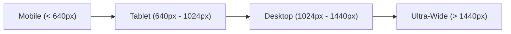

# Digital Seba — Design System & UI Documentation

**Brand Name:** Digital Seba (ডিজিটাল সেবা)
**Primary Brand Accent:** Royal Indigo / Modern Blue
**Design Paradigm:** Glassmorphism, Modern Dark Mode, Component Isolation
**Last Verified Baseline:** October 19, 2026 (`main` branch)
**Document Status:** ACTIVE & MAINTAINED

---

## 1. Brand Identity & Visual Assets

### 1.1 Brand Logo
- **Primary Brandmark:** [`assets/images/logo.png`](../assets/images/logo.png) (Dimensions: 70KB high-resolution circular badge).
- **Favicons:**
  - Standard ICO: [`favicon.ico`](../favicon.ico)
  - PNG Favicons: `favicon-16x16.png`, `favicon-32x32.png`
  - Mobile Web Clip: [`apple-touch-icon.png`](../apple-touch-icon.png) (180×180 PNG)
- **Brand Title & Bilingual Typographic Convention:**
  - English: `Digital Seba`
  - Bengali: `ডিজিটাল সেবা`
  - Combined Navigation Label: `Digital Seba — Your Digital World, Simplified`

---

## 2. Color Palette & Verified Design Tokens

The core application defines CSS variables across [`assets/css/main.css`](../assets/css/main.css), [`assets/css/components.css`](../assets/css/components.css), and page-scoped styles:

### 2.1 Dark Mode (Primary / Default)
| Token Name | Verified Hex / RGBA Value | Usage / Component |
| :--- | :--- | :--- |
| `--bg-primary` | `#0b0f19` / `#0f172a` | Deep canvas background |
| `--bg-secondary` | `#1e293b` | Secondary sections, panels |
| `--card-bg` | `rgba(15, 23, 42, 0.85)` | Glassmorphic floating cards |
| `--border-color` | `rgba(255, 255, 255, 0.1)` | Card borders, dividers |
| `--text-primary` | `#f8fafc` | Main headings and high-emphasis body text |
| `--text-secondary` | `#94a3b8` | Subtitles, descriptions, secondary copy |
| `--text-muted` | `#64748b` | Timestamps, metadata, inactive labels |
| `--accent-blue` | `#2563eb` / `#3b82f6` | Primary action buttons, active navigation indicators |
| `--accent-indigo` | `#4f46e5` | Radial ambient glow backgrounds |
| `--accent-emerald` | `#10b981` | Success alerts, active status pills |
| `--accent-amber` | `#f59e0b` | Admin role badges, warning notifications |
| `--accent-rose` | `#ef4444` | Suspended account badges, delete/error triggers |

### 2.2 Light Mode
| Token Name | Verified Hex / RGBA Value | Usage / Component |
| :--- | :--- | :--- |
| `--bg-primary` | `#f8fafc` | Light canvas background |
| `--card-bg` | `#ffffff` | Clean white card surfaces |
| `--border-color` | `rgba(0, 0, 0, 0.1)` | Subtle card outlines |
| `--text-primary` | `#0f172a` | High-contrast dark text |
| `--text-secondary` | `#475569` | Secondary dark text |

---

## 3. Typography & Internationalization

Digital Seba is natively bilingual, supporting seamless English and Bengali switching:

### 3.1 Font Families
- **English & Numeric UI:** `'Inter', -apple-system, BlinkMacSystemFont, 'Segoe UI', Roboto, sans-serif`
- **Bengali Script:** `'Noto Sans Bengali', 'SolaimanLipi', sans-serif`
- **Permanent Identifiers & Code:** `'ui-monospace', 'SFMono-Regular', 'Menlo', 'Monaco', 'Consolas', monospace`

### 3.2 Typographic Hierarchy
- **Hero Title (`H1`):** `2.5rem`–`3.5rem` (`40px`–`56px`), `font-weight: 800`, letter-spacing `-0.02em`.
- **Section Heading (`H2`):** `1.75rem`–`2.25rem` (`28px`–`36px`), `font-weight: 700`.
- **Card Title (`H3`):** `1.15rem`–`1.25rem` (`18px`–`20px`), `font-weight: 600`.
- **Body Text:** `0.95rem`–`1.0rem` (`15px`–`16px`), `line-height: 1.6`.
- **Caption / Badge:** `0.75rem`–`0.85rem` (`12px`–`14px`), `font-weight: 600`, uppercase/tracked.

---

## 4. Shared UI Components & Patterns

### 4.1 Alpha Header & Universal Navigation
- **Structure:** Brandmark logo, bilingual title, desktop mega-menu dropdowns, instant search bar, theme toggle, language switch pill (`EN` / `বাং`), and user authentication avatar/login button.
- **Mega-Menu Dropdowns:** Multi-column categorized panels with icon badges, descriptive subtitles, and deep-linking targets.
- **Mobile Drawer:** Hamburger toggle (`#mobileMenuToggle`) that expands an off-canvas drawer with full touch support and ARIA expansion attributes.

### 4.2 Interactive Cards (Glassmorphism)
- **Visual Style:** Semi-transparent background (`rgba(15, 23, 42, 0.85)`), backdrop blur filter (`backdrop-filter: blur(16px)`), subtle 1px border (`rgba(255, 255, 255, 0.08)`).
- **Micro-Interactions:** Smooth hover lift (`transform: translateY(-2px)`), accent glow shadow (`box-shadow: 0 12px 24px -10px rgba(37, 99, 235, 0.3)`), and high-contrast focus rings.

### 4.3 Buttons & Actions
- **Primary CTA:** Solid accent background (`#2563eb`), white text, rounded corners (`8px`–`12px`), smooth hover brightness transition.
- **Secondary / Ghost:** Transparent background with subtle border (`border: 1px solid var(--border-color)`), hover background tint.
- **Danger / Destructive:** Crimson background (`#ef4444`) with confirmation prompt modal.

### 4.4 Form Controls & Modals
- **Form Inputs:** Dark-tinted surface, crisp border outline, clear placeholder text, focus state with 2px accent outline.
- **Modals:** Fixed full-screen backdrop overlay (`rgba(0, 0, 0, 0.7)`), centered glassmorphic dialog box, accessible keyboard escape listener, and explicit close button (`&times;`).

---

## 5. State Management & Visual Feedback

### 5.1 Loading States
- **Spinners:** CSS-animated dual-ring spinners (`border: 2px solid rgba(255,255,255,0.2); border-top-color: #2563eb; border-radius: 50%; animation: spin 0.8s linear infinite;`).
- **Table / Directory Loaders:** Full-width centered loading row with animated indicator.

### 5.2 Empty States
- Illustrated card or subtle icon badge with friendly bilingual message (e.g., *"কোন ব্যবহারকারী পাওয়া যায়নি"* / *"No users found matching your search"*).

### 5.3 Error & Success Alerts
- **Success:** Emerald green border and background tint (`rgba(16, 185, 129, 0.15)`), checkmark icon.
- **Error / Denied:** Crimson border and background tint (`rgba(239, 68, 68, 0.15)`), warning triangle icon.
- **Warning:** Amber border and background tint (`rgba(245, 158, 11, 0.15)`).

---

## 6. Theme Switching System

The platform includes 20 alternate homepage theme directories stored under [`homepage-themes/`](../homepage-themes/) (21 total variants including the root Alpha homepage):
- **Theme Selection:** Handled via [`theme-selector/index.html`](../theme-selector/index.html) or runtime previewer [`preview.html`](../preview.html). (Note: Runtime selectability, completeness, and stability vary across individual alternate themes; manual verification per theme is advised).
- **Persistence:** Selected theme key is saved to `localStorage.getItem('ds_theme')`.
- **Runtime Guard:** [`assets/js/theme-guard.js`](../assets/js/theme-guard.js) runs synchronously in `<head>` to prevent theme flashing during page load.

---

## 7. Responsive Breakpoints

- **Mobile Viewports (`< 640px`):** Single-column grid, stacked inputs, collapsible hamburger navigation, full-width modal sheets.
- **Tablet Viewports (`640px - 1024px`):** 2-column card grids, condensed navigation, full desktop table with horizontal scroll if needed.
- **Desktop Viewports (`> 1024px`):** 3-column or 4-column tool grids, full mega-menu navigation, fixed sidebar / modal overlays.
