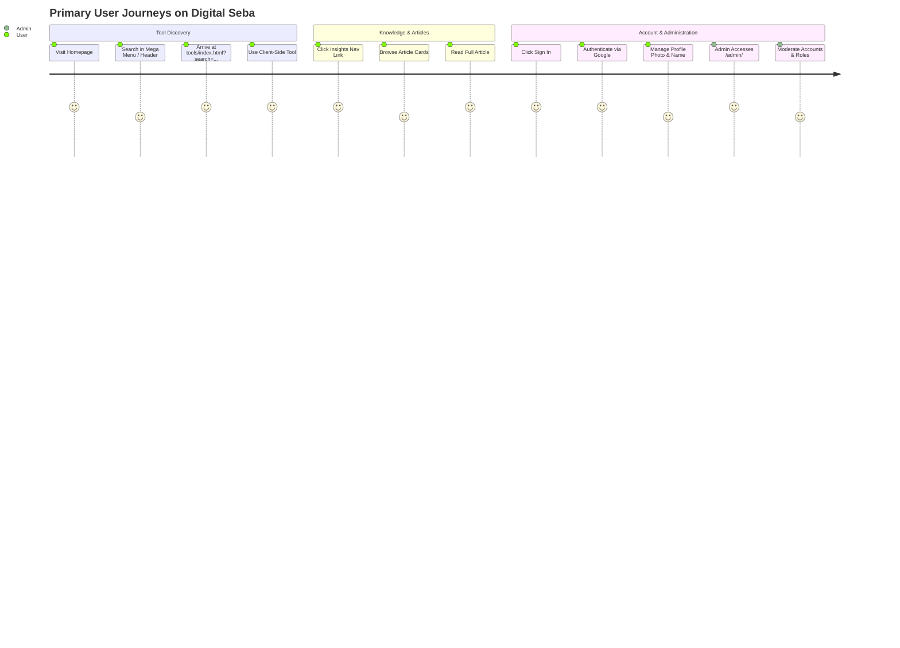

# Digital Seba — Product Requirements Document (PRD)

**Project Name:** Digital Seba (ডিজিটাল সেবা)
**Primary Domains:** `digitalseba.pages.dev` | `digiseba.shop` | `seba.pro.bd`
**Hosting Environment:** Cloudflare Pages (Edge Static CDN)
**Last Verified Baseline:** October 19, 2026 (`main` branch)
**Document Status:** ACTIVE & MAINTAINED

---

## 1. Executive Product Overview

**Digital Seba** is an all-in-one digital public utility platform and service portal designed primarily for Bangladeshi citizens, digital service center entrepreneurs, students, job-seekers, and everyday web users.

The platform aggregates essential government service links, automated document generation tools, client-side photo and PDF processing utilities, educational resources, a live streaming IPTV entertainment hub, a gamified Pomodoro productivity workspace (Focus Mode), and a technology/insights knowledge base into a unified, responsive web ecosystem.

The application operates as a **pure client-side static web application** deployed via Cloudflare Pages, backed by Firebase Authentication, Cloud Firestore, and Firebase Storage for user profile management and administrative access.

---

## 2. Target Users & Needs Analysis

| User Persona | Verified Needs & Workflows | Key Features Used |
| :--- | :--- | :--- |
| **Bangladeshi Citizens** | Rapid access to official portals for National ID (NID) verification/correction, passport applications, birth and death certificates, and land records without navigating complex government directories. | `/tools/`, `/tools/nid/`, `/tools/passport/`, `/tools/birth/`, `/tools/land/`, `/services/Voteshondhan/` |
| **Digital Service Center (Udc/Cyber Cafe) Operators** | Rapid, client-side tools to crop and resize passport-sized photos, compress PDFs, generate student registration certificates, and calculate government fees without paying for desktop software. | Passport Photo Studio (`tools/index.html`), PDF Compressor/Merger, Certificate Generator (`services/`) |
| **Students & Job Seekers** | Curated educational resources, job preparation materials, Windows ISOs, software tools, and tech articles. | `/resources/`, `/insights/`, `/focus-mode/` |
| **General Public** | Access to Bangladeshi and international live news, sports, entertainment streams, and digital utility calculators (age, currency, loan). | `/live-tv/`, `/tools/`, Currency & Age Calculators |
| **Platform Administrators** | User directory visibility, role assignment, account moderation, and broadcast management. | `/login/`, `/profile/`, `/admin/` |

---

## 3. Existing Verified Product Capabilities

### 3.1 Consolidated Citizen & Digital Tools Suite (`/tools/`)
The tool suite houses over 60 client-side utilities inside [`tools/index.html`](../tools/index.html), including:
- **Government & Citizen Utilities:** NID card verification links, voter list lookup (`services/Voteshondhan/`), voter transfer form generator (`services/voter-transfer/`), student registration and certificate generator, passport application guidance, birth and death registration launchers (`#mode-dob`), and e-mutation land record links.
- **Photo & Image Studio:** Passport photo cropper/resizer with preset millimeter dimensions, background color replacer, image compressor, and format converter (WebP/PNG/JPEG).
- **PDF & Document Utilities:** Client-side PDF merger, splitter, page extractor, and stamp creator.
- **Calculators & Converters:** Age calculator, currency converter, loan EMI calculator, unit converter, and word counter.
- **Generators:** QR code generator, barcode generator, marriage biodata formatter, and invoice generator.
- **Deep-Linking & Query Filtering:** Supports direct URL search parameters (e.g., `?search=Passport`, `?search=AI`) that auto-filter and scroll directly to corresponding cards.

### 3.2 Insights Hub (`/insights/`)
- Repurposed knowledge base for educational content, digital service tutorials, and technological insights.
- Dynamic article reader located at [`services/article/index.html`](../services/article/index.html) with slug-based routing (`/services/:slug` rewritten to `/services/article/index.html?slug=:slug`).
- Content authoring editor located at [`services/editor/index.html`](../services/editor/index.html).

### 3.3 Live TV & IPTV Portal (`/live-tv/`)
- Curated streaming hub offering 90+ live channels categorized by Sports, News, Entertainment, Islamic, Kids, and International.
- Powered by `hls.js` for adaptive HLS stream playback with full-screen and picture-in-picture modes.
- Custom channel catalog with search, favorite pinning, and responsive channel grid.

### 3.4 Drive Resources Directory (`/resources/`)
- Curated index of software, Windows ISO files, educational guides, and government templates.
- Features real-time client-side instant search, category filtering, and direct external download links.

### 3.5 Focus Mode Workspace (`/focus-mode/`)
- Gamified Pomodoro productivity suite (AshFocus integration).
- Features customizable focus timers, ambient soundscapes (rain, coffee shop, white noise), task list with local persistence, and productivity statistics.

### 3.6 User Profile & Admin Management System (`/login/`, `/profile/`, `/admin/`)
- **Authentication:** Google OAuth sign-in and email/password authentication powered by Firebase Auth.
- **User Profile (`/profile/`):** Permanent, immutable Firebase UID display with 1-click clipboard copy, editable display name with validation, and profile avatar upload with client-side canvas compression (256×256 WebP under 50KB) uploaded to Firebase Storage with Firestore fallback.
- **Admin Dashboard (`/admin/`):** Dedicated administration panel restricted to verified administrators (`digitalsebamail@gmail.com` and delegated admins in `/admins/{uid}`). Provides user directory inspection, real-time search, role editing (`user`/`admin`), account status toggling (`active`/`suspended`), and self-lockout prevention.

### 3.7 Dynamic Theme Engine (`/theme-selector/`, `/portal/`, `homepage-themes/`)
- 20 alternate theme directories stored under [`homepage-themes/`](../homepage-themes/) (21 total variants including the root Alpha homepage: Alpha, Aero, Apex, Core, Echo, Flux, Genesis, Horizon, Ignite, Infinity, Lumina, Neon, Nexus, Nova, Orbit, Prism, Pulse, Quantum, Spark, Vertex, Zenith). (Note: Individual variant runtime stability and selectability vary; not all variants are verified as fully working).
- Persistent user theme selection stored in `localStorage` and enforced globally via `assets/js/theme-guard.js`.

---

## 4. Current User Journeys

---

## 5. Scope & Known Limitations

### In-Scope (Maintained & Supported)
- Pure client-side execution on Cloudflare Pages static edge network.
- Consolidated tool model inside `tools/index.html` with physical redirect stubs on disk for local dev server compatibility.
- Responsive design for mobile (375px+), tablet (768px+), and desktop (1280px+).
- Bilingual user interface (Bengali `bn` and English `en`).

### Verified Limitations
- **No Custom Origin Server:** The platform runs no Node.js server, Python backend, or server-side relational database in production.
- **External Dependency Reliance:** Subtools rely on third-party government endpoints (NID, Passport, Bangladesh Land Ministry), which may experience intermittent external downtime or CAPTCHA enforcement.
- **Pending Legal Policy Stubs:** Dedicated Privacy Policy (`/pages/privacy.html`) and Terms of Service (`/pages/terms.html`) have not yet been authored; existing footer links currently trigger the project's custom `404.html` error page (`NEEDS DECISION`). Authoring dedicated static policy pages is recommended to resolve broken footer links and establish clear public terms, subject to owner review.
- **CDN Script Dependencies:** Several frontend UI libraries (Tailwind CDN, FontAwesome, Hls.js) are loaded from public CDNs without Subresource Integrity hashes (`WARNING`).

---

## 6. Measurable Success Criteria

1. **Navigation Reliability:** 0 broken internal links, 0 `Cannot GET` errors across VS Code Live Server and Cloudflare Pages (Verified: 26/26 automated tests pass).
2. **Error Handling:** Non-existent routes return HTTP 404 with custom branded [`404.html`](../404.html) instead of server default error pages.
3. **Data Security:** 100% of sensitive Firestore writes enforced by server-side security rules (`firestore.rules`); zero public write-access to `/admins` or sensitive `/users` fields.
4. **Performance:** Subtool initial interactions execute in under 1.5 seconds on 4G mobile connections.
5. **Accessibility:** Semantic HTML elements, ARIA labels on modal toggles, and keyboard focus outlines.

---

## 7. Out-of-Scope Changes

- Full rewrite or migration to Next.js server-side rendering (SSR), Remix, Nuxt, or other server-based frameworks.
- Replacing Firebase Auth/Firestore with custom self-hosted PostgreSQL/MySQL/Node backends.
- Modifying production DNS, Cloudflare zone configuration, or Firebase Console security credentials without explicit owner authorization.
