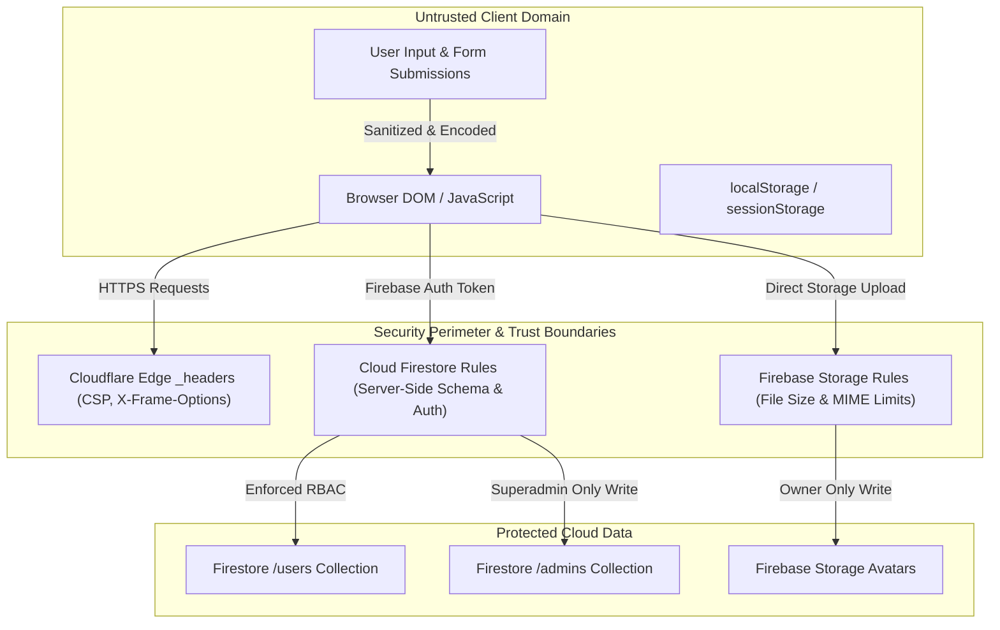

# Digital Seba — Security Architecture & Policy Documentation

**Audited Domain:** `digitalseba.pages.dev` | `digiseba.shop` | `seba.pro.bd`
**Platform:** Cloudflare Pages Static CDN + Firebase BaaS
**Last Verified Baseline:** October 19, 2026 (`main` branch)
**Document Status:** ACTIVE & MAINTAINED

---

## 1. Threat Model & Trust Boundaries

Digital Seba employs a **zero-server static architecture**. Because there is no private origin backend (e.g. Node.js or Express API), the platform's security relies entirely on:
1. **Edge Enforcement:** Cloudflare Pages HTTP security headers (`_headers`) and redirect controls (`_redirects`).
2. **Server-Side BaaS Authorization:** Cloud Firestore declarative security rules (`firestore.rules`) and Firebase Storage rules (`storage.rules`).
3. **Client-Side Defense-in-Depth:** Input validation, strict entity encoding (XSS mitigation), protocol checks, and route access guards.



---

## 2. Authentication & Authorization Boundaries

### 2.1 Identity Providers
- **Provider:** Firebase Authentication using Google OAuth 2.0 (`google.com`) and Email/Password capability.
- **Client Configuration:** Firebase v8 compat SDK initialized centrally in [`assets/js/firebase-init.js`](../assets/js/firebase-init.js).
- **Session Handling:** Firebase Auth manages tokens via IndexedDB and in-memory caches. Google Drive bearer tokens in `tele.js` are strictly scoped to `sessionStorage` and purged upon sign-out.

### 2.2 Role-Based Access Control (RBAC)
- **Superadmin:** Hardcoded owner identity (`digitalsebamail@gmail.com` with verified email) defined in `firestore.rules`. Holds full authority to assign admin privileges, delete users, and modify system settings.
- **Delegated Admin:** Identified by document existence in `/databases/$(database)/documents/admins/$(request.auth.uid)` with `role: 'admin'`. Cannot promote users to admin or revoke superadmin status.
- **End User:** Authenticated user with `role: 'user'` in `/users/$(request.auth.uid)`. Permitted to modify only their own profile details (`displayName`, `phone`, `photoURL`). Cannot alter `role`, `status`, or `isAdmin`.
- **Suspended Account:** Accounts flagged with `status: 'suspended'` in `/users/{uid}` are blocked by `firestore.rules` from performing database write operations or accessing administrative functions.

---

## 3. Declarative Security Rules

### 3.1 Cloud Firestore Rules (`firestore.rules`)
File: [`firestore.rules`](../firestore.rules)
- **Least-Privilege Fallback:** Zero-trust catch-all blocks all unmapped collections:
  ```javascript
  match /{document=**} {
    allow read, write: if false;
  }
  ```
- **`/admins/{adminId}`:**
  - Read: Superadmin OR active non-suspended admin checking own record.
  - Write: Strictly Superadmin (`digitalsebamail@gmail.com`).
- **`/users/{userId}`:**
  - Read: Owner (`request.auth.uid == userId`) OR verified Admin.
  - Create: Normal users can only set `role: 'user'` and `status: 'active'`.
  - Update: Normal users cannot alter `role`, `status`, or `isAdmin`. Delegated admins can update status (suspend/activate), but cannot alter `role` or `isAdmin`.
  - Delete: Restricted to Superadmin.
- **`/contacts/{contactId}` & `/newsletter/{newsletterId}`:**
  - Validates exact allowed payload keys, maximum string lengths, and email format.

### 3.2 Firebase Storage Rules (`storage.rules`)
File: [`storage.rules`](../storage.rules)
- Path: `users/{userId}/{allPaths=**}`
- **Read:** Permitted to all authenticated users.
- **Write:** Permitted only to the account owner (`request.auth.uid == userId`), strictly enforcing maximum file size of 3MB and image MIME types `image/(jpeg|png|webp|gif)`.

---

## 4. Secret Management & Client-Side Configuration

### 4.1 Categorization of Client Identifiers & Credentials
To avoid ambiguity, the repository's configuration elements are categorized into four distinct security tiers:

1. **Genuine Private Secrets (None in Repository):**
   - The codebase contains **zero** private service-account JSON keys, private database connection strings, Stripe secret keys, or cloud master passwords.
2. **Public Browser Configuration:**
   - The Firebase `projectId`, `authDomain`, `storageBucket`, and `appId` in [`assets/js/firebase-init.js`](../assets/js/firebase-init.js) are non-secret client configuration parameters required by the Firebase browser SDK. They do not grant administrative authority; database access is governed by [`firestore.rules`](../firestore.rules).
3. **OAuth Client Identifiers:**
   - [`tools/js/tele.js`](../tools/js/tele.js) and Firebase Auth use public Google OAuth Client IDs (e.g. `*.apps.googleusercontent.com`). These are public application identifiers displayed in user consent dialogs and do not constitute private secrets.
4. **Browser-Executed API Keys Requiring Restrictions:**
   - **Firebase Web API Key:** Present in `assets/js/firebase-init.js`.
   - **Google Drive API Key:** An API key identifier is present in `tools/js/tele.js` for client-side Google Drive integration.
   - *Security Guidance:* Because these keys execute in client browsers, they are visible by design. They must NOT be assumed to be private secrets, nor should they be assumed safe without configuration. It is strongly recommended that the repository owner review the Google Cloud Console for both associated projects to confirm that:
     - HTTP Referrer Restrictions are enforced (`https://digitalseba.pages.dev/*`, `https://digiseba.shop/*`, `https://seba.pro.bd/*`, and local testing hosts).
     - API Restrictions limit the keys strictly to their required services (e.g. Token Service, Firestore, Drive API).

---

## 5. Client-Side XSS Mitigation & Input Sanitization

1. **Entity Encoding:** Dynamic text insertions in [`assets/js/resources-render.js`](../assets/js/resources-render.js), [`live-tv/js/live-chat.js`](../live-tv/js/live-chat.js), and utility scripts use strict entity replacement (`&` &rarr; `&amp;`, `<` &rarr; `&lt;`, `>` &rarr; `&gt;`, `"` &rarr; `&quot;`, `'` &rarr; `&#039;`).
2. **Safe Link Navigation:** Dynamic resource card URLs validate protocols (`http:`, `https:`, `/`) and strictly block dangerous `javascript:` and `data:text/html` URI schemes.
3. **Canvas Image Sanitization:** Profile avatar uploads are parsed through an HTML5 `<canvas>` element, which rasterizes the image and discards embedded EXIF metadata, SVG scripts, and binary polyglot payloads before generating a clean WebP data URL.

---

## 6. HTTP Security Headers (`_headers`)

File: [`_headers`](../_headers)
- **Clickjacking Protection:** `X-Frame-Options: SAMEORIGIN`
- **MIME Sniffing Prevention:** `X-Content-Type-Options: nosniff`
- **Referrer Privacy:** `Referrer-Policy: strict-origin-when-cross-origin`
- **Permissions Policy:** `Permissions-Policy: camera=(self), microphone=(), geolocation=()`
- **Content Security Policy (CSP):** Restricts script, style, font, connect, and frame sources strictly to approved CDNs, Google APIs, Firebase endpoints, YouTube embeds, and self. Disallows object plugins (`object-src 'none'`).

---

## 7. Outstanding Security Risks & Recommendations

| Risk Item | Severity | Current Status | Recommended Remediation |
| :--- | :---: | :---: | :--- |
| **Missing Subresource Integrity (SRI)** | Medium | `WARNING` | Add cryptographic `integrity="sha384-..."` attributes to 33 external CDN `<script>` tags. |
| **External Cloudflare Worker Dependency** | Low | `WARNING` | Live TV player connects to `https://iptv-proxy.trionine.workers.dev/?url=`. Worker domain should enforce strict origin allowlisting. |
| **Production Header Deployment** | High | `READY` (Local Pass) | The hardened `_headers` file is committed locally but has not been deployed to live Cloudflare Pages production (`digitalseba.pages.dev`). |
| **Missing Legal Policy Pages** | Low | `NEEDS DECISION` | `/pages/privacy.html` and `/pages/terms.html` currently return 404; recommend authoring dedicated static pages to resolve broken footer navigation and provide clear user terms, subject to owner review. |
